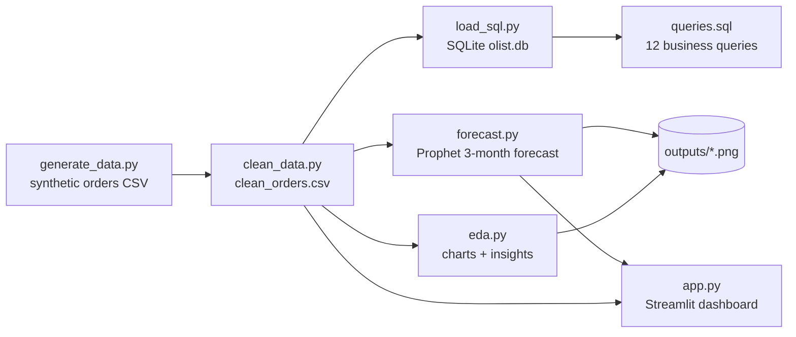
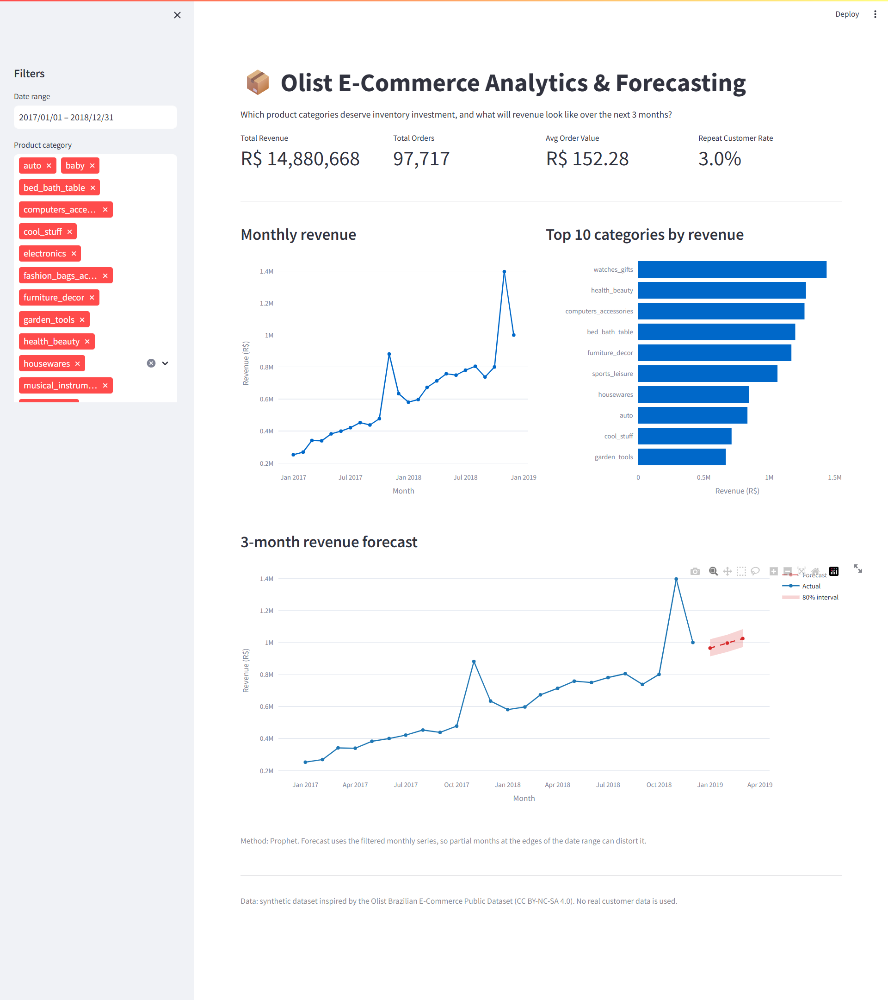
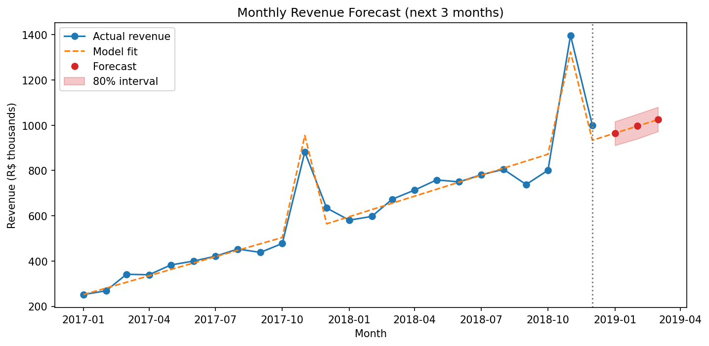
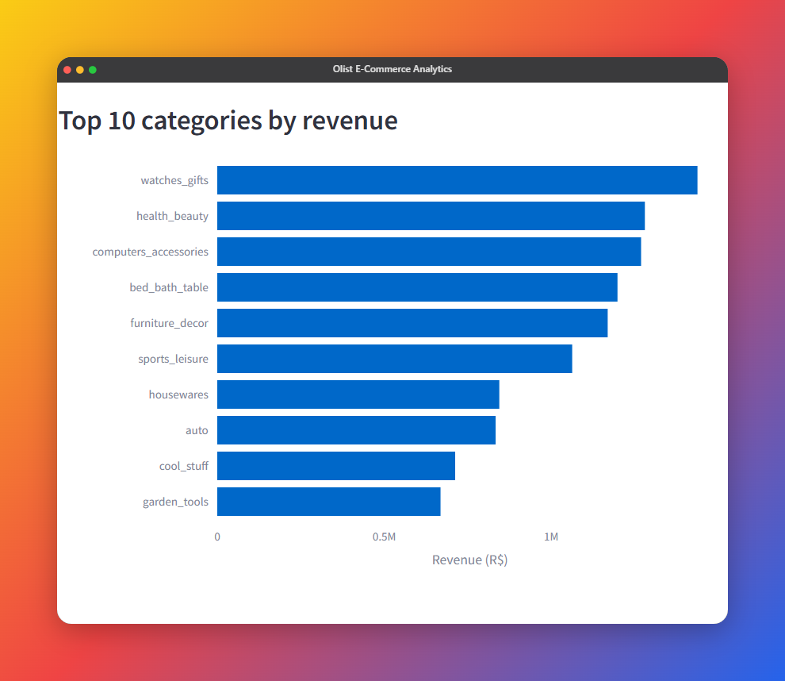

# Olist E-Commerce Analytics & Forecasting Pipeline

End-to-end e-commerce analytics: data cleaning, SQL analysis, Prophet forecasting, and a Streamlit dashboard on 100k orders.


> **Data disclosure:** the dataset in this project is **synthetic**. It is
> *inspired by* the Olist Brazilian E-Commerce Public Dataset but contains no
> real orders or customers. All numbers below come from the synthetic data
> (seed 42) and demonstrate the method, not real market facts.

## Business Problem

Olist is a Brazilian e-commerce marketplace. This project answers:

> **Which product categories should Olist prioritize for inventory investment,
> and what is the 3-month revenue forecast to guide marketing spend?**

The key tension in the data: **revenue grew strongly, but only ~3% of customers
ever made a repeat purchase.** The analysis therefore looks at growth *and*
retention together.

## Dataset

| Item | Detail |
|---|---|
| Source | Generated by `src/generate_data.py` (synthetic, seed 42) |
| Size | 100,000 rows, Jan 2017 - Dec 2018 |
| Columns | `order_id`, `customer_id`, `order_status`, `order_purchase_timestamp`, `order_delivered_customer_date`, `payment_value`, `product_category`, `customer_state`, `review_score`, `is_repeat_customer` |
| Built-in realism | Growth trend, Black Friday / Christmas seasonality, 3% repeat customers, slower delivery to remote states, lower reviews for slow deliveries |
| Deliberate data issues | ~0.5% duplicate orders, ~1.3% cancelled/unavailable orders, missing delivery dates, reviews, categories and payment values (cleaned in `clean_data.py`) |

**Attribution:** inspired by the
[Brazilian E-Commerce Public Dataset by Olist](https://www.kaggle.com/datasets/olistbr/brazilian-ecommerce)
(CC BY-NC-SA 4.0). No data from the original dataset is included or
redistributed. Because the inspiration is licensed non-commercially, treat this
project as a portfolio / educational work.

**Modelling notes**

- `customer_id` is persistent here, so repeat purchases can be observed. (In the real Olist data, `customer_id` changes per order and `customer_unique_id` must be used instead.)
- The data has no estimated delivery date, so an order is **late** when delivery takes more than 20 days.

## Architecture



## Tech Stack

- **Python 3.11+**: pandas, NumPy, Matplotlib, Seaborn
- **Prophet**: time-series forecasting
- **SQLite + SQLAlchemy**: SQL layer
- **Streamlit + Plotly**: interactive dashboard
- **GitHub**: hosting

## Folder Structure

```
olist-ecommerce-analytics/
├── data/
│   └── .gitkeep
├── src/
│   ├── __init__.py
│   ├── generate_data.py   # synthetic dataset (100k rows)
│   ├── clean_data.py      # cleaning + derived columns
│   ├── eda.py             # 6 charts + 5 insights
│   ├── load_sql.py        # CSV -> SQLite (optionally runs the queries)
│   ├── queries.sql        # 12 commented business queries
│   ├── forecast.py        # Prophet 3-month forecast
│   └── app.py             # Streamlit dashboard
├── outputs/
│   └── .gitkeep
├── requirements.txt
├── README.md
├── .gitignore
└── LICENSE
```

## Key Insights

Generated by `python src/eda.py` on the synthetic data:

1. **Strong growth with a Black Friday spike.** Revenue grew **81%**, from R$5.29M (2017) to R$9.59M (2018). November 2018 was the peak month at R$1.40M, **74% above October**.
2. **Revenue is spread across many categories, but a few lead.** `watches_gifts`, `health_beauty` and `computers_accessories` generate **28%** of revenue. `watches_gifts` also has the highest average order value (R$257).
3. **Geographic concentration.** São Paulo (SP) drives **42%** of revenue, and the top 3 states (SP, RJ, MG) account for **67%**.
4. **The retention gap.** Only **3.0%** of customers ever order again, and they generate just **6.2%** of revenue. Growth is almost entirely new-customer acquisition.
5. **Slow delivery hurts reviews.** **14.6%** of orders take more than 20 days. Late orders average **3.21 stars vs 4.22** for on-time orders (correlation between delivery days and review score: r = -0.46).

## Business Recommendations

1. **Concentrate inventory on the top categories, and stock up before November.** Prioritise `watches_gifts`, `health_beauty` and `computers_accessories` (28% of revenue combined), and build stock ahead of Black Friday, when monthly revenue jumped 74%.
2. **Invest in retention before scaling acquisition spend.** Repeat customers are only 3% of the base, yet each is worth roughly 2x the revenue of a one-time buyer. Post-purchase email, loyalty offers (SQL query 10 lists customers with 3+ orders) and cross-sell campaigns are the cheapest growth lever.
3. **Fix fulfilment in slow regions and size marketing to the forecast baseline.** The slowest states (AC, RR, AM, AP) average 28-30 days delivery, and the resulting low reviews hurt conversion. Add regional carriers or SLAs before pushing marketing there. Plan Jan-Mar spend from the forecast baseline (not the holiday-inflated last quarter) and treat the upper confidence bound as a stretch target.

## Screenshots

<!-- After running the project, add your screenshots, e.g. in a docs/ folder:



-->

_Screenshots coming soon: add them after running the project (see "How to Run")._

## How to Run

```bash
# 1. Clone and enter the project
git clone https://github.com/alfrid420/olist-ecommerce-analytics.git
cd olist-ecommerce-analytics

# 2. Create a virtual environment (Python 3.11+ recommended)
python -m venv .venv
source .venv/bin/activate        # Windows: .venv\Scripts\activate

# 3. Install dependencies
pip install -r requirements.txt

# 4. Run the pipeline in order
python src/generate_data.py      # -> data/olist_orders_dataset.csv
python src/clean_data.py         # -> data/clean_orders.csv
python src/eda.py                # -> outputs/*.png + insights in the console
python src/load_sql.py --run-queries   # -> data/olist.db + results of the 12 queries
python src/forecast.py           # -> outputs/forecast.png + predictions

# 5. Launch the dashboard
streamlit run src/app.py
```

> If Prophet fails to install on your system, `forecast.py` automatically falls
> back to a simple linear-trend forecast so the pipeline still completes.

## Future Improvements

- Swap in the real Olist dataset (using `customer_unique_id`) and compare the findings
- Add cohort retention analysis and customer lifetime value (CLV) modelling
- Forecast per category and per state, with backtesting (rolling-origin cross-validation)
- Use the real estimated delivery date to define lateness
- Add automated tests (pytest) and a CI workflow (GitHub Actions)
- Deploy the dashboard on Streamlit Community Cloud

## Author

**Monu Mishra**, GitHub: [@alfrid420](https://github.com/alfrid420)

Released under the [MIT License](LICENSE).
